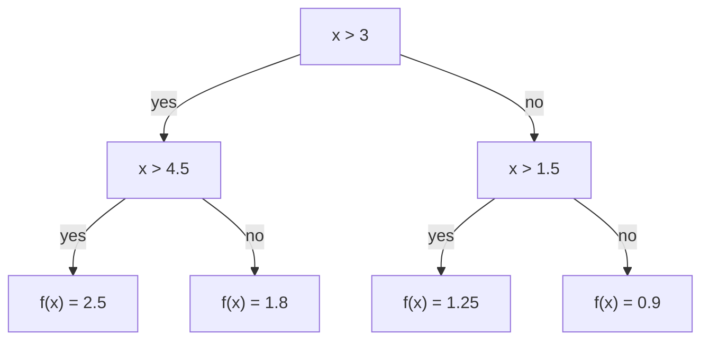

We process prediction model with arguments further if the condition matches or else stops if there's a risk.

Systolic pressue: (x)

---

## 1. Decision Tree as a Prediction Model

A prediction model $\hat{y}_n := f(\mathbf{x}_n; \boldsymbol{\theta})$ can also be structured as a decision tree.

```mermaid
graph TD
    A["Systolic pressure: (x<sub>n,1</sub> > 91)"] -- yes --> B["risk (y&#770;<sub>n</sub> = 1)"]
    A -- no --> C["Age: (x<sub>n,2</sub> > 62.5)"]
    C -- yes --> D["risk (y&#770;<sub>n</sub> = 1)"]
    C -- no --> E["Sinus tachycardia: (x<sub>n,3</sub> = 1)"]
    E -- yes --> F["risk (y&#770;<sub>n</sub> = 1)"]
    E -- no --> G["low-risk (y&#770;<sub>n</sub> = 0)"]
```

> **Figure 6:** San Diego Medical Center

---

## 2. Decision Tree as a Step-wise Function

We process function based on conditions, if its exceeds than one or else another.

A decision tree partitions the feature space into axis-aligned regions, forming a **step-wise constant function**.

### Mathematical Representation

$$\hat{y} = f(x) = \begin{cases} 
0.9 & \text{if } x \le 1.5 \\
1.25 & \text{if } 1.5 < x \le 3 \\
1.8 & \text{if } 3 < x \le 4.5 \\
2.5 & \text{if } x > 4.5 
\end{cases}$$
