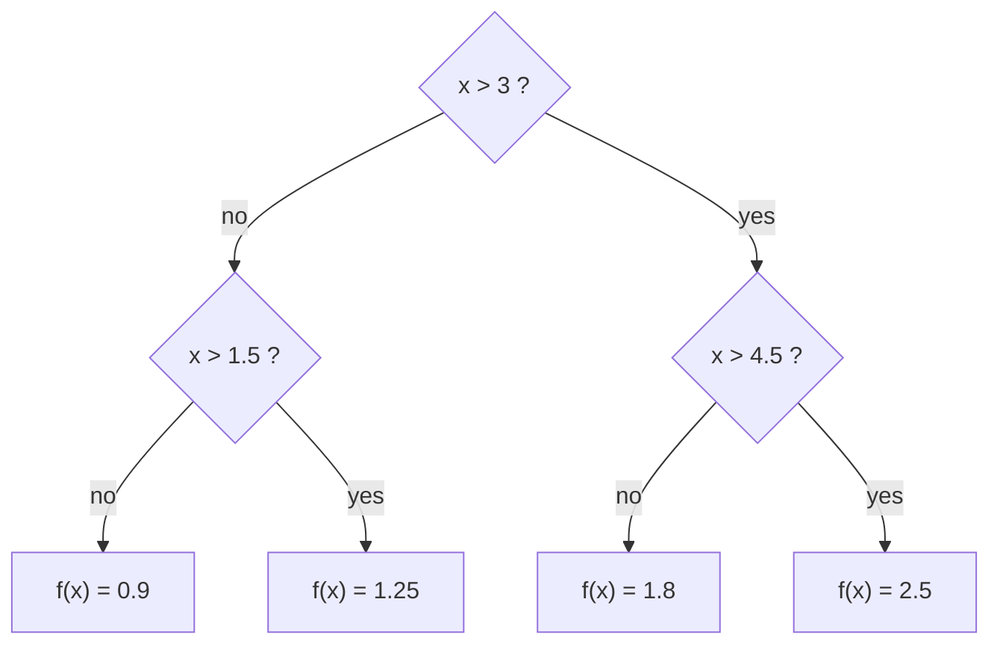

![[Pasted image 20261116151952.png]]


---
# Decision Trees as Step Functions

> [!summary] A regression decision tree splits the input space into intervals and predicts a **constant value in each one**. The result is a staircase (step function) approximating the data.

## The Example

Data: noisy upward trend of $y$ against $x$. The fitted tree $f(x)$ is a staircase with 4 steps.



As a piecewise function:

$$ f(x) = \begin{cases} 0.9 & x \le 1.5 \ 1.25 & 1.5 < x \le 3 \ 1.8 & 3 < x \le 4.5 \ 2.5 & x > 4.5 \end{cases} $$

|Region|Path|Prediction|
|---|---|---|
|$x \le 1.5$|no → no|0.9|
|$1.5 < x \le 3$|no → yes|1.25|
|$3 < x \le 4.5$|yes → no|1.8|
|$x > 4.5$|yes → yes|2.5|

## Terminology

- **Decision node**: asks a question about a feature (e.g. $x > 3$)
- **Leaf**: holds the final prediction
- **Root**: the first decision node

## Why Those Leaf Values?

> [!note] Leaf value = mean of the training targets in that region $$\hat{y}_{R} = \frac{1}{|R|}\sum_{i \in R} y_i$$ This minimizes squared error within the region, so each step sits at the center of its points.

## How Splits Are Chosen

At each node, try candidate thresholds $s$ and pick the one that minimizes the total squared error of the two child regions:

$$ \min_{s} \left[ \sum_{i \in R_L(s)} (y_i - \bar{y}_L)^2 + \sum_{i \in R_R(s)} (y_i - \bar{y}_R)^2 \right] $$

Repeat recursively until a stopping rule is met (max depth, min samples per leaf).

## Key Takeaways

- A tree is a set of thresholds producing **piecewise-constant** predictions
- Finite outputs: 4 leaves means only 4 distinct predictions
- **More depth** → narrower steps, closer fit, higher risk of [[Overfitting]]
- **Less depth** → coarser steps, simpler, risk of underfitting

> [!warning] Weaknesses Unstable (small data changes can change the tree) and usually less accurate than ensembles like [[Random Forest]] or [[Gradient Boosting]].

## Code

```python
from sklearn.tree import DecisionTreeRegressor, plot_tree
import numpy as np

X = np.sort(np.random.uniform(0, 6, 40)).reshape(-1, 1)
y = 0.4 * X.ravel() + 0.5 + np.random.normal(0, 0.2, 40)

tree = DecisionTreeRegressor(max_depth=2).fit(X, y)  # depth 2 -> up to 4 leaves
plot_tree(tree, feature_names=["x"], filled=True)
```

![[Pasted image 20261116153357.png]]

---
## Max Depth and Min Samples Per Leaf
 
Let $d$ = `max_depth`, $m$ = `min_samples_leaf`, $n$ = training samples, $L$ = number of leaves.
 
### Formulas
 
| Quantity | Formula |
|---|---|
| Leaves allowed by depth | $L \le 2^d$ |
| Leaves allowed by $m$ | $L \le \lfloor n/m \rfloor$ |
| Combined cap | $L \le \min(2^d,\ \lfloor n/m \rfloor)$ |
| Node can split only if | $n_{\text{node}} \ge 2m$ |
| Depth needed for $L$ leaves (balanced) | $d \ge \lceil \log_2 L \rceil$ |
| Deepest possible tree given $m$ (chain) | $d_{\max} = \lfloor n/m \rfloor - 1$ |
| Fractional $m$ (e.g. `0.05`) | $m = \lceil f \cdot n \rceil$ |
 
### Worked example
 
$n = 100$, $m = 10$, $d = 5$:

$$L \le \min\!\left(2^d,\ \left\lfloor \frac{n}{m} \right\rfloor\right)$$
 
- Depth cap: $2^5 = 32$ leaves
- Sample cap: $\lfloor 100/10 \rfloor = 10$ leaves
- $L \le \min(32, 10) = 10$, so **$m$ is the binding constraint**
- Balanced depth actually used: $\lceil \log_2 10 \rceil = 4$, so $d = 5$ never gets reached
- A node with 19 samples cannot split; one with 20 can (10 + 10)
### Which one binds?
 
> [!tip]
> - $2^d < n/m$: **depth** limits the tree. Lowering $m$ changes nothing.
> - $2^d > n/m$: **min samples** limits the tree. Raising $d$ changes nothing.
 
### Effect on the model
 
| Setting | Bias | Variance | Risk |
|---|---|---|---|
| Large $d$, small $m$ | low | high | [[Overfitting]] |
| Small $d$, large $m$ | high | low | underfitting |
 
### Starting points
 
- $d$: 3 to 10
- $m$: 1 to 5% of $n$ (larger for noisy data)
- Tune both with cross-validation:

```python
from sklearn.model_selection import GridSearchCV
from sklearn.tree import DecisionTreeRegressor
 
grid = GridSearchCV(
    DecisionTreeRegressor(),
    {"max_depth": [2, 3, 5, 8], "min_samples_leaf": [1, 5, 10, 20]},
    cv=5,
)
grid.fit(X, y)
print(grid.best_params_)
```
---
![[Pasted image 20261116154929.png]]

