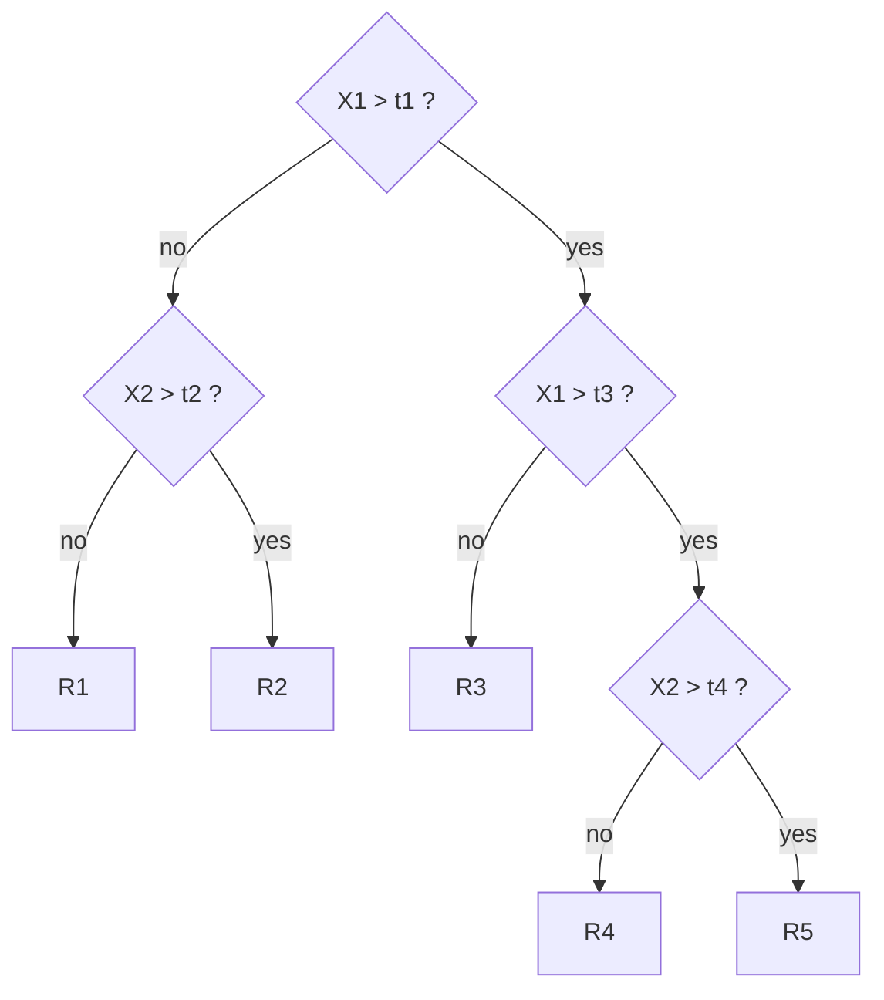
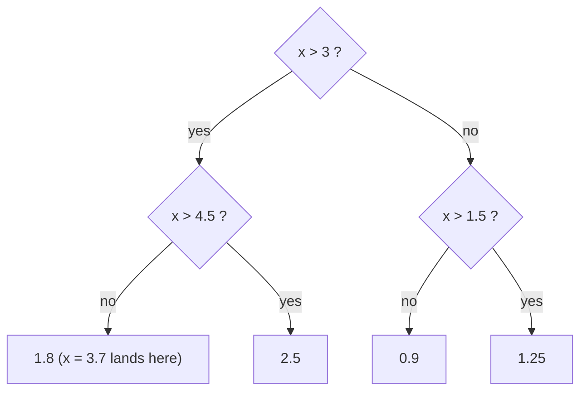

# Feature Space Partitioning and Tree Predictions

> [!summary] A tree **partitions the feature space into regions and predicts a constant value in each region**. This extends the 1D step function from [[Decision Trees - Step Functions]] to any number of features.

## Slide 1: Feature Space Partitioning

### What a tree produces

With two features $X_1$ and $X_2$, the tree cuts the plane with axis-aligned lines. The right-hand plot on the slide corresponds to this tree:



|Region|Conditions|
|---|---|
|$R_1$|$X_1 \le t_1,\ X_2 \le t_2$|
|$R_2$|$X_1 \le t_1,\ X_2 > t_2$|
|$R_3$|$t_1 < X_1 \le t_3$|
|$R_4$|$X_1 > t_3,\ X_2 \le t_4$|
|$R_5$|$X_1 > t_3,\ X_2 > t_4$|

> [!note] Each split cuts **one existing region** into two. A threshold does not span the whole plot: $t_2$ only cuts the left part, $t_4$ only the right part.

### The left plot (not tree-generated)

The slide's left partition cannot be produced by recursive binary splitting, because its lines cannot be explained as one split of one region.

> [!warning] Reading of the figure The slide does not state this explicitly. It matches the usual textbook contrast between a general partition and a tree-generated one.

### Why binary splits?

- Any $k$-ary split can be written as a sequence of binary splits (a 3-way split is two binary splits in a row)
- Binary splits are faster to search and often predict better, since they divide the data more gradually

## Slide 2: Tree Predictions

### Setup

Dataset:

$$\mathcal{D} = {(x_i, y_i)}_{i=1}^{N} \subset (\mathcal{X} \times \mathcal{Y})^N$$

Partition the input space $\mathcal{X}$ into regions $R_1, \dots, R_J$.

### Prediction per region

Collect the targets of all training points that fall in $R_j$ and aggregate them:

$$\hat{y}^{(R_j)} = \text{aggregate}\Big(\pi_y\big({(x,y) \in \mathcal{D} \mid x \in R_j}\big)\Big)$$

- $\pi_y$ is a projection: it keeps only the $y$-value of each pair
- The aggregate is the **mean** for regression and the **majority class** for classification

### Formal definition

A tree is fully specified by its regions plus one prediction per region:

$$\langle R_1, \dots, R_J,\ \hat{y}^{(R_1)}, \dots, \hat{y}^{(R_J)} \rangle$$

Predicting for a new $x$ means finding its region and returning that region's value:

$$f(x) = \sum_{j=1}^{J} \hat{y}^{(R_j)} \cdot \mathbb{1}[x \in R_j]$$

## Connection to the Step-Function Example

In 1D, the regions were intervals ($x \le 1.5$, $1.5 < x \le 3$, $3 < x \le 4.5$, $x > 4.5$), and the leaf values $0.9, 1.25, 1.8, 2.5$ were the means of $y$ in each interval. In higher dimensions the regions become rectangles (or boxes).

This also explains why the two equivalent trees from the earlier slides are the same model: they define the **same regions and the same predictions**, only the order of questions differs.

## Key Takeaways

- A tree = a set of regions + one constant prediction per region
- Recursive binary splitting yields **axis-aligned rectangular** regions
- Leaf values are aggregates (mean or majority class) of training targets in the region
- Different tree structures can encode the same function
---

![[Pasted image 20261116161443.png]]

---

---

## title: Tree Prediction Model aliases: [Tree Prediction, Indicator Function, Tree Parameters] tags: [machine-learning, decision-trees, regression, supervised-learning] created: 2026-11-16 source: Dr. Simon Bultmann, Machine Learning, University of Freiburg related: ["[[Feature Space Partitioning and Tree Predictions]]", "[[Decision Trees - Step Functions]]"]

# Tree Prediction Model

> [!summary] A tree is a function $f(x;\theta)$ defined by its **regions** and one **constant prediction per region**. To predict, find the region containing $x$ and return that region's value. The indicator function is the formal tool that "selects" the right region.

## 1. Slide: Tree Predictions (recap)

Given dataset $\mathcal{D} = {(x_i, y_i)}_{i=1}^N$, partition the input space $\mathcal{X}$ into regions $R_1, \dots, R_J$. For each region, aggregate the targets of the training points inside it:

$$\hat{y}^{(R_j)} = \text{aggregate}\Big(\pi_y\big({(x,y) \in \mathcal{D} \mid x \in R_j}\big)\Big)$$

- $\pi_y$ keeps only the $y$-value of each pair
- aggregate = **mean** (regression) or **majority class** (classification)

The tree is then specified by:

$$\theta = \langle R_1, \dots, R_J,\ \hat{y}^{(R_1)}, \dots, \hat{y}^{(R_J)} \rangle$$

> [!note] Parameters $\theta$ is just the **list of regions** plus the **list of leaf values**. The regions come from the split questions (thresholds); the values come from aggregating training targets.

## 2. Slide: Tree Prediction Model

$$f(x;\theta) = \sum_{j=1}^{J} \hat{y}^{(R_j)} \cdot \mathbb{1}(x \in R_j)$$

### Indicator function

$$\mathbb{1}(a) = \begin{cases} 1 & \text{if } a = \text{T} \ 0 & \text{otherwise} \end{cases}$$

Here $a$ is a true/false statement, and $\text{T}$ means "true". So $\mathbb{1}(x \in R_j)$ is 1 if $x$ lies in region $R_j$, otherwise 0.

### Why the sum collapses to one term

> [!important] Regions are disjoint Every $x$ lies in **exactly one** region. So exactly one indicator is 1 and all others are 0, which leaves a single surviving term:
> 
> $$f(x;\theta) = \hat{y}^{(R_k)} \quad \text{where } x \in R_k$$

The sum is simply a compact way to write "look up the value of the region that $x$ falls in".

## 3. Worked Example (the step function)

Regions and values from [[Decision Trees - Step Functions]]:

|$j$|$R_j$|$\hat{y}^{(R_j)}$|
|---|---|---|
|1|$x \le 1.5$|0.9|
|2|$1.5 < x \le 3$|1.25|
|3|$3 < x \le 4.5$|1.8|
|4|$x > 4.5$|2.5|

Predict for $x = 3.7$:

$$ \begin{aligned} f(3.7) &= 0.9\cdot\mathbb{1}(3.7 \in R_1) + 1.25\cdot\mathbb{1}(3.7 \in R_2) + 1.8\cdot\mathbb{1}(3.7 \in R_3) + 2.5\cdot\mathbb{1}(3.7 \in R_4) \ &= 0.9\cdot 0 + 1.25\cdot 0 + 1.8\cdot 1 + 2.5\cdot 0 \ &= 1.8 \end{aligned} $$

Same answer as walking the tree: $x > 3$ yes, then $x > 4.5$ no, giving leaf $1.8$.



## 4. Two Views of the Same Model

|View|What it is|Good for|
|---|---|---|
|**Tree traversal**|Ask questions from root to leaf|Fast prediction, interpretability|
|**Indicator sum**|$\sum_j \hat{y}^{(R_j)}\mathbb{1}(x \in R_j)$|Math: proofs, loss functions, comparing trees|

This is also why two differently shaped trees can be the **same model**: they give the same $\theta$ (same regions, same values), just reached by different question orders.

## 5. Code

```python
import numpy as np

# theta: regions as (low, high] intervals + leaf values
regions = [(-np.inf, 1.5), (1.5, 3), (3, 4.5), (4.5, np.inf)]
values  = [0.9, 1.25, 1.8, 2.5]

def indicator(cond):
    return 1 if cond else 0

def f(x):
    return sum(v * indicator(lo < x <= hi) for (lo, hi), v in zip(regions, values))

print(f(3.7))  # 1.8
```

## Key Takeaways

- $\theta$ = regions + one value per region
- $f(x;\theta)$ = sum over regions of (value $\times$ indicator that $x$ is in the region)
- Disjoint regions mean only **one term is non-zero**, so the sum equals a lookup
- Indicator sum and tree traversal are equivalent descriptions of the same function

## Related

- [[Feature Space Partitioning and Tree Predictions]]
- [[Decision Trees - Step Functions]]
- [[Overfitting]]

---


